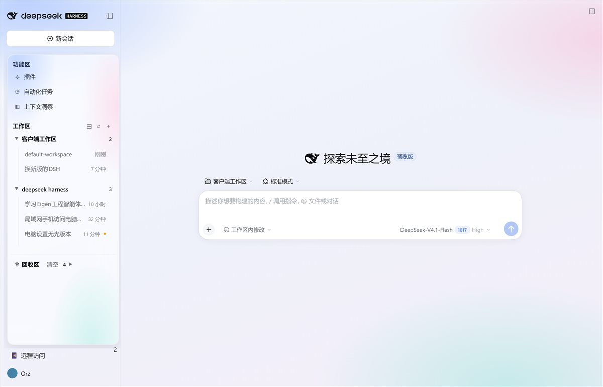

# Sidebar Plus · a three-zone sidebar for DeepSeek Harness Web

Rebuilds the DSH Web sidebar into three zones — **Functions / Workspaces / Recycle bin** — and wraps it in a soft "liquid glass" surface.



## What it does

| Zone | Content |
|---|---|
| Functions | Plugins, Schedules, Context Insights (switch the main panel) |
| Workspaces | Per-workspace collapse, one-click expand/collapse all, hover `＋` to start a session in that workspace |
| Recycle bin | Deleted sessions; each row offers **Restore** and **Delete**, plus a **Empty** action in the header |

### A real recycle bin

Deleting a session archives it, moves `~/.dsh/sessions/<workspace>/<id>` into `~/.dsh/storages/recycle/<id>/` and writes a `meta.json` (title + timestamp). Restoring moves the files back, unarchives the session, re-inserts it through the official `workspaces.insertSessionBefore()` and refreshes its projections — **the row appears immediately, no page reload**.

Sessions that are actually running are refused, with a message.

### Drag and drop

- drag a row up/down → reorder inside its workspace (persisted as the registry's manual order)
- drag onto a workspace header → move/restore it there
- drag onto the **Recycle bin** header → move it to the bin

### Search

The `⌕` button in the Workspaces header filters sessions by title across all workspaces. `Esc` closes.

## Design

A small, executable spec rather than taste: glass surfaces tinted with `color-mix()` from the host's `--dsw-alias-*` tokens, one accent colour reserved for state, borders instead of boxes, and a spring-ish grid transition for expanding groups. Details in [DESIGN.md](DESIGN.md).

## Install

Requires DeepSeek Harness Web (`dsh web`).

1. Link this folder as a dependency of your DSH profile:

   ```bash
   cd <dsh profile dir>   # e.g. ~/.dsh/profiles/web
   pnpm add link:/path/to/this/repo
   ```

2. Add `@local/sidebar-plus` to `dsh.profile.bundles` in that profile's `package.json`.
3. Restart `dsh web`.

The plugin registers one host route family (`/sidebar-plus/{list,delete,restore,purge,empty}`), replaces the `sidebar.workspaces` slot, and injects the global glass styles.

## Data and rollback

| Item | Location |
|---|---|
| Recycle payload | `<DSH_HOME>/storages/recycle/<session-id>/` (`meta.json` + `logs/`) |
| Local API token | `<DSH_HOME>/sidebar-plus-token` |
| Rollback | Settings → Plugins → disable **Sidebar Plus**; the shipped sidebar returns and the injected styles are removed |

## Known limitations

- The skin's global rules key off class-name **suffixes** (`_frame`, `_sidebarCol`, `_centerCol`, `_root`, `_page`) and ARIA roles. An upstream style rewrite may make parts of it fall back to the default look; it does not break the app.
- Web only; the TUI and desktop shell are untested.
- Recycle rows show the title captured at delete time; sessions without one show their id.

## License

MIT
