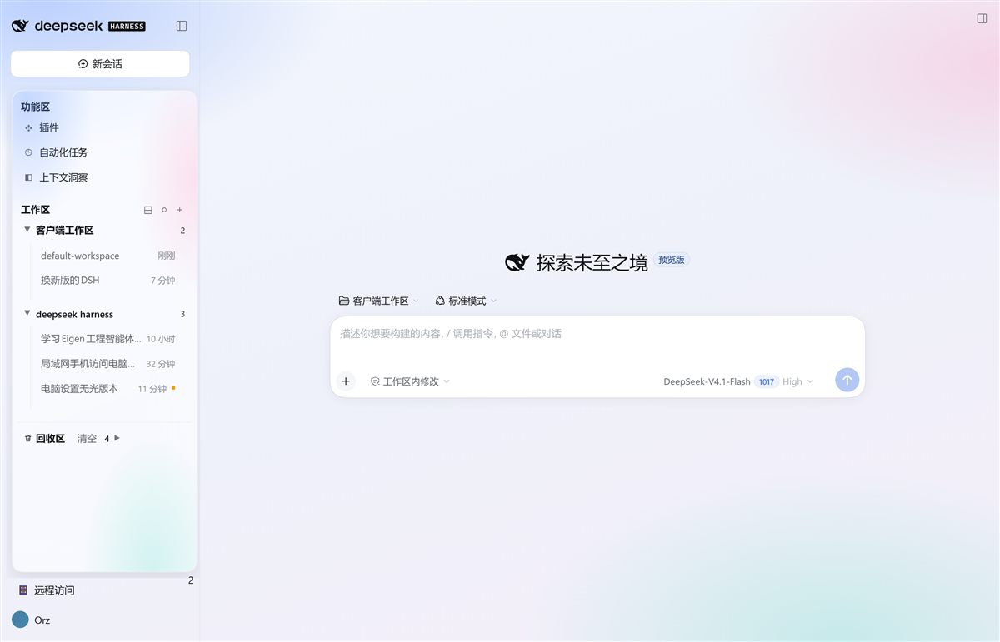
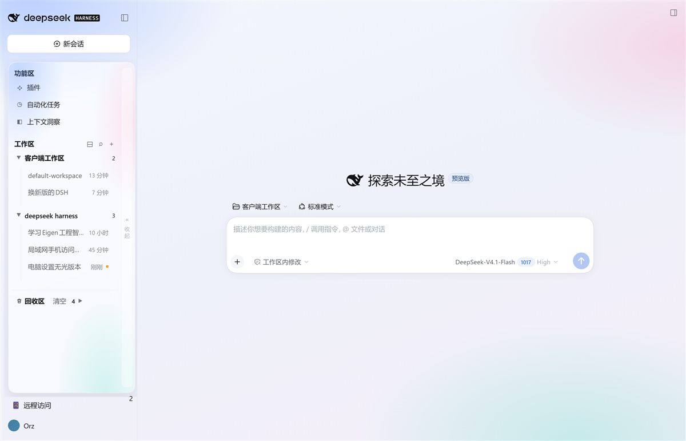
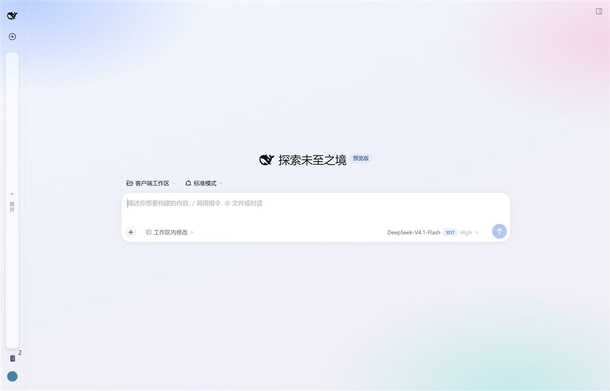
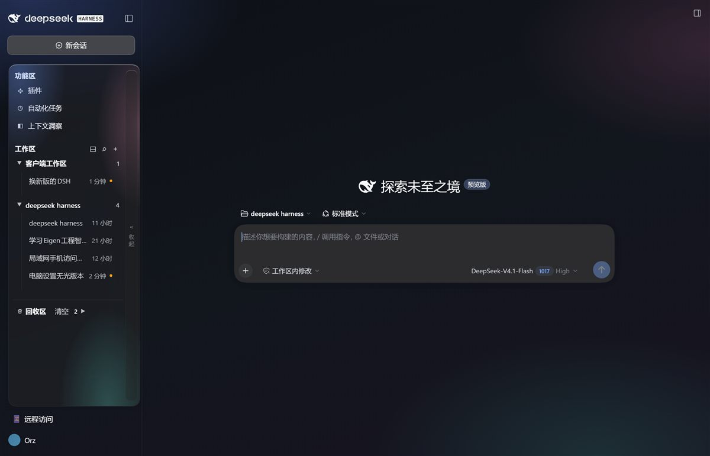

# Sidebar Plus · DSH Web 侧边栏增强

把 DeepSeek Harness Web 的侧边栏重做成三区结构（功能区 / 工作区 / 回收区），并套上一套 iOS 液态玻璃质感的皮肤。



## 为什么做这个

DSH 默认侧边栏把「插件 / 自动化任务 / 上下文洞察」放在最上面，工作区列表在下面，删掉的会话没有找回入口。这个插件把三者重新组织成**三个可分区的块**，并补上「回收区」——删掉的对话进垃圾桶，可以随时恢复，也可以彻底删除。

界面部分不是堆装饰：颜色只用来表达状态（选中 / 运行中 / 危险），结构靠边框和留白，动效只服务于「东西从哪来、到哪去」。

## 功能

### 三个分区

| 分区 | 内容 |
|---|---|
| 功能区 | 插件、自动化任务、上下文洞察（点击直接切换中央面板） |
| 工作区 | 每个工作区可独立折叠；一键全部展开/收起；悬停出现 `＋` 在该工作区新建对话 |
| 回收区 | 被删除的会话；展开后每条只有「恢复」与「删除」两个动作，头部有「清空」 |

### 回收区（真正的垃圾桶）

- 删除会话 = 归档 + 把会话日志目录移动到 `~/.dsh/storages/recycle/<session-id>/`，并写入 `meta.json`（含标题与删除时间）
- 恢复 = 移回原目录 + 解除归档 + 通过官方 `workspaces.insertSessionBefore` 插回工作区，**立即出现在列表里，无需刷新**
- 删除 = 只删这一条；清空 = 清掉全部
- 正在运行的会话会被拒绝删除，并给出提示

### 拖拽

| 拖拽 | 效果 |
|---|---|
| 会话行上下拖 | 同工作区内排序（写入 registry 的手动顺序） |
| 会话拖到工作区标题 | 移动/恢复到该工作区 |
| 会话拖到「回收区」标题 | 移入回收区 |

`⋯` 菜单和拖拽是等价的两条路径，都可以用。

### 搜索

工作区标题右侧的 `⌕`，按标题跨全部工作区过滤；`Esc` 关闭。



### 折叠

侧边栏收起后，内容不会再被压成一列竖排文字，而是变成一条整高的可点击窄条（`» 展开`）。展开态下，右侧有一条同尺寸的长条（`« 收起`），两者位置对称、点哪里都能切换。




### 深色主题

同一套规则在深色下不需要另写一套：画布在 `@media (prefers-color-scheme: dark)` 里换成深色渐变，面板底色仍由 `color-mix()` 从宿主 token 派生，因此文字对比度和层级关系保持一致。



## 设计语言

一套可执行的规则，不是"看着调"：

| 维度 | 规则 |
|---|---|
| 材质 | 面板 `color-mix(bg-layer-1 58%, transparent)` + `backdrop-filter: blur(26px) saturate(1.45)`；整窗底色是一层蓝/粉/青三色的 `radial-gradient`，`background-attachment: fixed` |
| 层级 | 窗口渐变 → 页面容器透明 → 卡片/输入框保留白色玻璃 |
| 颜色 | 只有三种彩色：选中（品牌蓝）、运行中（琥珀点）、危险（红，仅确认场景） |
| 字号 | 分区标题 13.5px/600，会话 13.5px/400，元信息 12px，搜索框 13.5px |
| 形状 | 面板 20px，行 11px，按钮 12px |
| 动效 | 分组展开/收起 `grid-template-rows: 0fr → 1fr`，460ms `cubic-bezier(.22,.9,.24,1.08)`；行错峰 26ms、`translateY(-6px) scale(.97) → 0/1` |

所有颜色从宿主 token（`--dsw-alias-*`）用 `color-mix` 派生，深色主题下会自动跟随，不是写死的浅色。

## 安装

要求：DeepSeek Harness Web（`dsh web`），插件系统可用。

### 用插件管理器

```bash
# 在插件目录执行
pnpm link /path/to/this/repo
```

或在 DSH 的「设置 → 插件」里把本目录作为本地 bundle 安装。

### 手动

1. 把本目录放进 DSH profile 的依赖里（`link:` 指向本目录）；
2. 在 profile 的 `package.json` → `dsh.profile.bundles` 追加 `@local/sidebar-plus`；
3. 重启 `dsh web`。

插件会注册：

- 宿主路由 `/sidebar-plus/{list,delete,restore,purge,empty}`
- 客户端插槽 `sidebar.workspaces`（替换官方工作区区块）
- 客户端全局样式（液态玻璃皮肤）

## 数据与回滚

| 项 | 位置 |
|---|---|
| 回收区数据 | `<DSH_HOME>/storages/recycle/<session-id>/`（`meta.json` + `logs/`） |
| 令牌 | `<DSH_HOME>/sidebar-plus-token`（本地文件，用于接口鉴权） |
| 回滚 | 设置 → 插件 → 关闭 Sidebar Plus，立刻回到官方侧边栏，注入的样式同步移除 |

删除 `storages/recycle/<id>/` 等于永久清除该条记录。

## 已知限制

- 皮肤的全局规则依赖 DSH 构建产物的**类名后缀**（`_frame`、`_sidebarCol`、`_centerCol`、`_root`、`_page`）与语义属性（`[role="dialog"]`）。上游大改样式后可能失效，表现是**局部退回默认样式，不会崩溃**。
- 只适配 DSH Web；TUI 与桌面壳未验证。
- 回收区的标题来自删除时的快照；删除前没有标题的会话会显示 ID。

## 结构

```
index.js            宿主半：路由 + 文件搬迁 + workspace.json 维护
client.js           客户端半：侧边栏 UI、拖拽、菜单、回收区、玻璃皮肤
cordis.patch.yml    bundle 插入行
locale/*.json       文案
icon.svg            图标
docs/screenshots/   截图
```

## License

MIT
